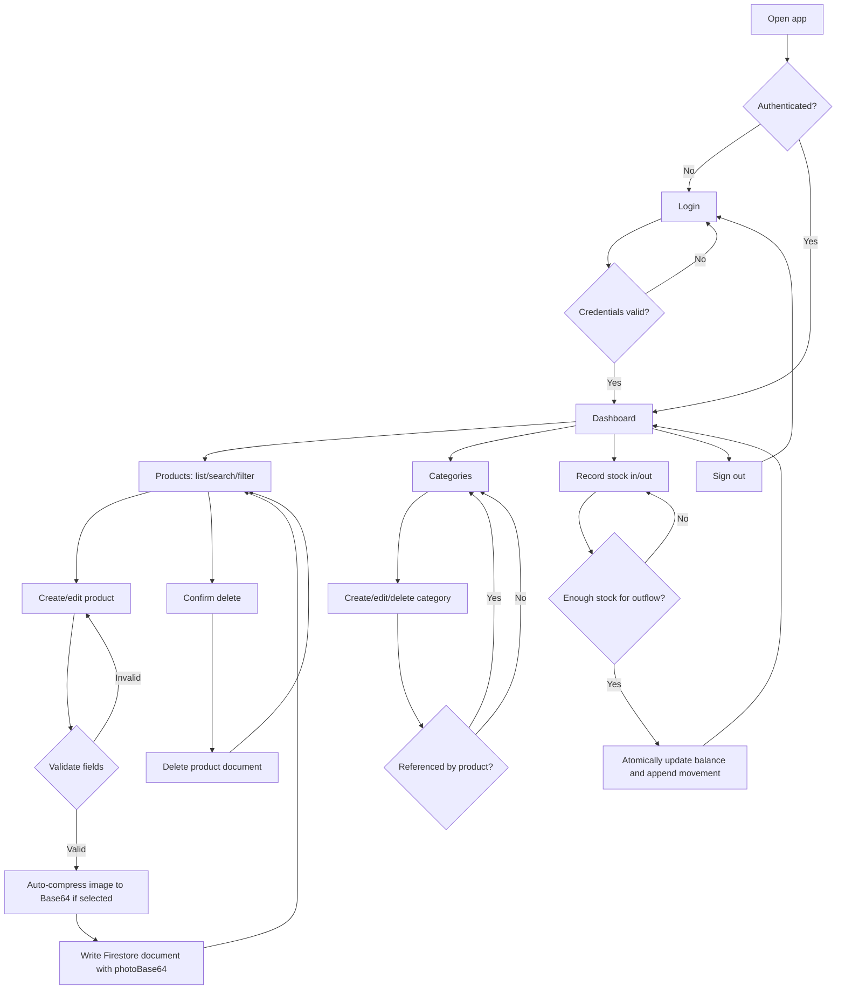

# User Flows

## Actors

- **Administrator:** authenticated user provisioned by the project owner.
- **Unauthenticated visitor:** may reach the sign-in page only.

## 1. Sign in and open dashboard

1. Visitor opens the application.
2. Auth state is checked by the Nuxt client plugin/composable.
3. If signed out, redirect to login state.
4. Admin enters email/password or selects **Masuk dengan Google**.
5. Firebase Authentication authenticates the credentials/OAuth popup.
6. System verifies the `admin: true` token claim; unauthorized accounts are immediately rejected and signed out.
7. On success, route to dashboard; on failure, show a clear error message.
8. Dashboard displays real-time inventory metrics and navigation.

## 2. Create or edit product

1. Admin opens Products and sees loading, empty, or a bounded realtime list.
2. Admin searches/filters or selects **Add product**.
3. Admin enters fields and optionally selects JPEG, PNG, or WebP image.
4. Client automatically compresses image to WebP Base64 string (< 300.000 characters).
5. Document is saved to Cloud Firestore with `photoBase64` and server timestamps.
6. Success notice appears and the list/detail reflects the change through the realtime listener.

## 3. Delete product

1. Admin selects Delete.
2. Confirmation dialog identifies the product and explains the action.
3. Cancel leaves data untouched.
4. Confirm deletes the Firestore document.
5. Show success or a recoverable error.

## 4. Manage categories

1. Admin opens Categories and creates/edits a trimmed name and optional description.
2. Duplicate normalized category name is rejected with a clear message.
3. On delete, application checks for products referencing the category.
4. If referenced, deletion is blocked and the admin is directed to reassign those products first.
5. Otherwise, admin confirms deletion and sees the updated list.

## 5. Record stock movement

1. Admin chooses a product, movement type (stock in/out), positive quantity, and reason.
2. The app submits a Firestore transaction.
3. The transaction reads the current balance, rejects an outflow greater than available stock, updates the balance, and creates an immutable movement record with admin identity and server timestamp.
4. Both writes commit together or neither does. Realtime balance and history update after commit.

## 6. Sign out

1. Admin selects Sign out.
2. Firebase Auth session is cleared.
3. Protected routes redirect to `/login`; listeners are unsubscribed and protected data is no longer shown.

## Flow diagram

